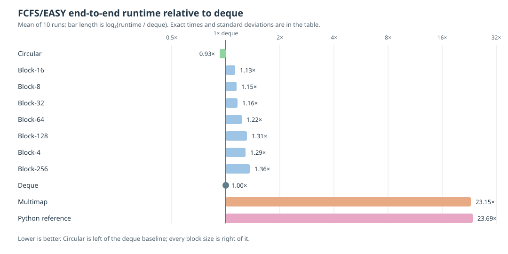

# Wait Queues

The FCFS scheduler can use `circular`, `deque`, `multimap`, or `block` wait
queues. The default is **`circular`**. This section collects the implementation
guides, testing instructions, and the evidence behind that default in one
place.

## Default queue and selection

Use the default **`circular`** queue for FCFS workloads unless a workload-specific
benchmark says otherwise:

```bash
${CMAKE_INSTALL_PREFIX}/bin/simulator trace.csv --priority_policy fcfs
```

`deque` remains the simplest fallback. The `block` and `multimap` queues remain available
for comparison, testing, and research.

## Benchmark record

This record was collected in October 2026 using
[`tests/test_traces/scale/huge_10000jobs.csv`](https://github.com/LLNL/dr_evt/blob/main/tests/test_traces/scale/huge_10000jobs.csv)
(10,001 jobs), 500 nodes, and
FCFS with EASY backfilling on an Intel Sapphire Rapids node (112 cores,
256 GB memory). Values are the mean of 10 end-to-end runs; `±` is the
population standard deviation.

**Benchmark script:** [`tests/benchmark_wait_queues.sh`](../../tests/benchmark_wait_queues.sh)

The timing includes trace parsing, scheduling and backfilling, event handling,
and trace output. It is not an isolated wait-queue microbenchmark. The queue
implementation is the intended variable, but the complete difference cannot be
attributed solely to queue operations.

These measurements characterize this workload and configuration only. Results
can change with the trace's arrival pattern, job sizes and durations, queue
depth, backfill policy, and machine.

For sampled hot-path measurements within the circular FCFS scheduler, see
[Performance Analysis](PERFORMANCE_ANALYSIS.md). That profile complements this
end-to-end queue comparison; the two measurements use different workloads and
should not be compared numerically.



| Implementation | Time (s) | vs deque | Change | Peak queue | Correctness |
| --- | ---: | ---: | ---: | ---: | --- |
| `deque` | 0.3230 ± 0.0394 | 1.00× | baseline | 8,904 | baseline |
| `multimap` | 7.4766 ± 0.0325 | 23.15× | +2,215% | 8,904 | PASS |
| **`circular`** | **0.2989 ± 0.0045** | **0.93×** | **−7.5%** | **8,904** | **PASS** |
| Python reference | 7.6510 ± 0.0128 | 23.69× | +2,269% | N/A | PASS |
| `block`-4 | 0.4171 ± 0.0014 | 1.29× | +29% | 8,904 | PASS |
| `block`-8 | 0.3716 ± 0.0017 | 1.15× | +15% | 8,904 | PASS |
| `block`-16 | 0.3646 ± 0.0007 | 1.13× | +13% | 8,904 | PASS |
| `block`-32 | 0.3756 ± 0.0009 | 1.16× | +16% | 8,904 | PASS |
| `block`-64 | 0.3953 ± 0.0039 | 1.22× | +22% | 8,904 | PASS |
| `block`-128 | 0.4227 ± 0.0021 | 1.31× | +31% | 8,904 | PASS |
| `block`-256 | 0.4380 ± 0.0035 | 1.36× | +36% | 8,904 | PASS |

`circular` was fastest overall, and `block`-16 was the fastest block size.

The 10 runs produced identical simulated-job output across every measured C++
queue variant, including `multimap`. The Python reference is an end-to-end
baseline. Its CSV schema is normalized before its job order and start/end times
are compared with the C++ `deque` schedule using a `0.001` tolerance.

### Conservative backfill result

Five end-to-end runs of `huge_2000jobs.csv` with 500 nodes, full conservative
backfilling, and `run_time_mode=limit` produced identical C++ schedules. This
is a separate workload from the EASY table above. Values are means; `±` is the
population standard deviation.

| Implementation | Time (s) | vs deque | Change | Correctness |
| --- | ---: | ---: | ---: | --- |
| `deque` | 18.0656 ± 0.0200 | 1.00× | baseline | baseline |
| **`circular`** | **17.0052 ± 0.0180** | **0.94×** | **−5.9%** | **PASS** |
| Python reference | 177.1860 ± 0.6558 | 9.81× | +881% | PASS |

### Hybrid backfill result

Ten end-to-end runs of `huge_10000jobs.csv` with 500 nodes,
`run_time_mode=limit`, reservation depth 32, and queue depth 32 produced
matching C++ and Python schedules. Values are means; `±` is the population
standard deviation.

| Implementation | Time (s) | vs deque | Change | Correctness |
| --- | ---: | ---: | ---: | --- |
| `deque` | 0.2399 ± 0.0021 | 1.00× | baseline | baseline |
| **`circular`** | **0.2355 ± 0.0012** | **0.98×** | **−1.8%** | **PASS** |
| Python reference | 2.5096 ± 0.0105 | 10.46× | +946% | PASS |

### Periodic hybrid backfill result

Ten end-to-end runs of `huge_10000jobs.csv` with 500 nodes,
`run_time_mode=limit`, a 30-second backfill interval, reservation depth 32,
and queue depth 500 measured the periodic circular scheduler at **3.8381 ±
0.0028 s** (range 3.834–3.844 s).

This is a circular-only measurement: periodic scheduling has no deque variant,
and the Python oracle was skipped. It is therefore not a queue-to-queue speedup
or an additional differential-correctness result.

| Implementation | Time (s) | vs circular | Correctness |
| --- | ---: | ---: | --- |
| `circular` | 3.8381 ± 0.0028 | 1.00× | periodic scheduler only |
| Python reference | N/A | N/A | skipped |

Reproduce the current benchmark modes with:

```bash
# EASY and hybrid, using the default trace
tests/benchmark_wait_queues.sh

# EASY only, using the 2,000-job trace
tests/benchmark_wait_queues.sh --backfill-policy easy \
  tests/test_traces/scale/huge_2000jobs.csv

# Hybrid only, with the recorded depth settings
tests/benchmark_wait_queues.sh --backfill-policy hybrid \
  --reservation-depth 32 \
  --backfill-queue-depth 32 \
  tests/test_traces/scale/huge_10000jobs.csv

# Periodic hybrid backfill. This measures the circular C++ scheduler; the
# Python oracle is skipped by default because it is impractically slow on
# long periodic traces.
tests/benchmark_wait_queues.sh --backfill-policy hybrid \
  --backfill-interval 30 \
  --reservation-depth 32 \
  --backfill-queue-depth 500 \
  tests/test_traces/scale/huge_10000jobs.csv

# Optional periodic Python differential check on a smaller trace. It can
# still take substantially longer than the C++ run.
tests/benchmark_wait_queues.sh --backfill-policy hybrid \
  --backfill-interval 30 \
  --reservation-depth 32 \
  --backfill-queue-depth 32 \
  --with-python-reference \
  tests/test_traces/scale/huge_2000jobs.csv

# Slurm-default-style periodic backfill: 30 s, reserve all tested jobs,
# and examine Slurm's default 500-job backfill prefix
tests/benchmark_wait_queues.sh --backfill-policy conservative \
  --backfill-interval 30 \
  --backfill-queue-depth 500
```

For every positive `--backfill-interval`, the benchmark skips the Python
reference unless `--with-python-reference` is supplied. This keeps the normal
10,000-job periodic benchmark practical; use the opt-in check only with a
small trace.

Run the same benchmark with:

```bash
tests/benchmark_wait_queues.sh
```

By default the script runs both comparisons. The EASY comparison tests `deque`,
`multimap`, `circular`, every supported `block` size, and the Python reference.
The hybrid comparison tests the deque and circular implementations plus the
Python oracle at queue and reservation depth 32. Each C++ comparison is
byte-for-byte against its deque baseline; Python schedules use a `0.001` time
tolerance.

To reproduce only the historical EASY table:

```bash
tests/benchmark_wait_queues.sh --backfill-policy easy
```

### Hybrid backfill comparison

Hybrid backfilling protects the first 32 waiting jobs considered in a pass.
The block and multimap queues do not implement this reservation algorithm, so
benchmark the deque and circular C++ implementations plus the Python oracle
separately:

```bash
tests/benchmark_wait_queues.sh --backfill-policy hybrid
```

Pass `--reservation-depth N` or `--backfill-queue-depth N` to model a
deployment-specific setting. Keep the reservation depth no larger than queue
depth: jobs outside the examined prefix cannot be protected. Slurm's analogous
`bf_job_part_count_reserve` has no portable default; a depth of `1` matches
EASY and a depth near the queue length approaches conservative backfilling.

The command byte-compares the C++ deque and circular schedules, then compares
the Python hybrid schedule with deque using a `0.001` time tolerance. It does
not replace the EASY results above; record the hybrid results in a separate
table with the workload, node count, run count, reservation depth, mean, and
standard deviation.

The unit and differential coverage is listed under
[Wait-queue tests](https://github.com/LLNL/dr_evt/blob/main/tests/README.md#wait-queue-tests).

## Queue guides

```{toctree}
:maxdepth: 2

BLOCK_WAIT_QUEUE
OUTPUT_TRACE_BUFFERS
```
