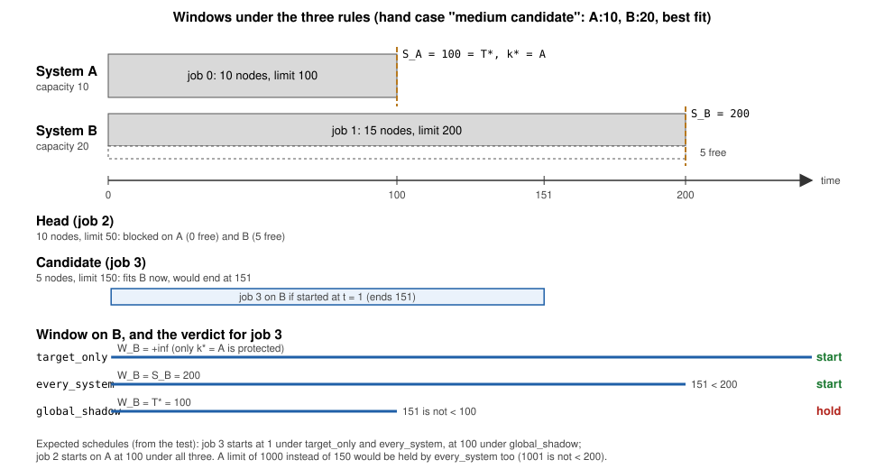
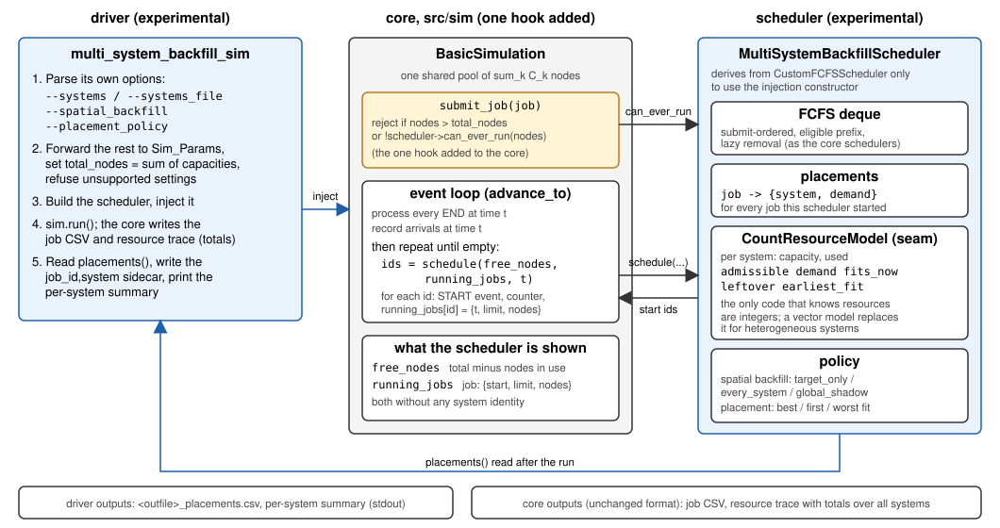
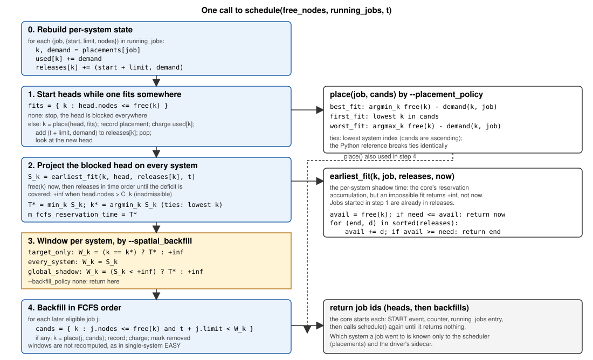

# Multi-system FCFS with spatial backfilling

`multi_system_backfill_sim` runs the core DR_EVT simulation with one FCFS
wait queue shared by K systems (or resource partitions) of possibly unequal
capacity. A job is bound to a system only when it starts. Resource matching,
the head reservation (shadow time), and backfilling are evaluated across the
whole set. The scheduler lives entirely in this directory; the only change
to `src/sim` is one virtual with a default, `SchedulerBase::can_ever_run()`,
consulted by `Simulation::submit_job()` so that a partitioning scheduler can
decline requests no partition can hold.

Status (2026-10-27): implemented for homogeneous node types and unequal
capacities, verified against the Python reference in this directory and,
with one system, against the stock simulator and the stock Python oracle.
Heterogeneous resource types are the next step; see "Toward heterogeneous
systems".

This is not the dispatcher in `../multi-cluster`. That program binds each
job to one system at submission (`choose_system`,
`mpi_performance_dispatch.cpp:803-943`) and then runs one independent
single-system EASY `Simulation` per system. Here there is one queue, one
scheduler, and late binding. The systems-table format of that experiment
(`#machine,size,GPU`) is accepted for configuration; the GPU column is
ignored.

## Scheduling model

Notation at a scheduling pass at time `t`:

- `free_k`: free nodes on system k. `R_k`: jobs running on k.
- Queue head h requests `n_h` nodes with estimate `e_h`; a candidate j
  requests `n_j`, `e_j`. Estimates are the jobs' `time_limit`, as in the
  single-system schedulers.
- `admissible(j, k)` := `n_j <= C_k`.
- `S_k`: the time at which h could start on k if nothing else starts on k,
  computed with the same projection as the single-system head reservation
  (free nodes now, then the sorted projected end times of `R_k` until the
  deficit is covered). `S_k = +inf` when h is not admissible on k.
- `T* = min_k S_k`, `k* = argmin_k S_k` (ties: lowest system index).

### Step 1: start heads

While the head fits now on at least one system, start it on the system
chosen by the placement policy, pop, and re-check the new head. Jobs started
in this step are included in the running set used by step 2, as the
single-system schedulers do with `effective_running_jobs`.

### Step 2: head blocked on every system

Compute `S_k` for every k, hence `T*` and `k*`. Scan the remaining eligible
jobs in FCFS order. Candidate j may start on k if `n_j <= free_k` and
`t + e_j < W_k` (strict, as in the single-system code). The window `W_k`
is the policy:

| `--spatial_backfill` | `W_k` | What it protects | Cost per pass |
|---|---|---|---|
| `target_only` (spatial EASY, default) | `T*` on `k*`, `+inf` elsewhere | `T*` on `k*` is not moved by backfilling; other systems' `S_k` may be pushed later | K projections |
| `every_system` (spatial conservative) | `S_k` | no `S_k` on any system is moved later by backfilling | K projections |
| `global_shadow` | `T*` on every admissible system | same as `every_system` | K projections |

- `target_only` is the faithful spatial analogue of EASY: exactly one
  reservation is protected, and anything that cannot move it is allowed. A
  backfill on `k != k*` cannot move `T*`, because it can only push `S_k`
  later and `S_k >= T*` already. Backfill on those systems is fit-only.
- `every_system` is the spatial conservative rule: on each system the
  window is that system's own head projection, so backfilling never pushes
  any `S_k` later. The projections are built from time limits and real jobs
  finish early, so keeping every `S_k` in place keeps every early-drain
  opportunity open for the head. Example with two systems:
  `S_A = t+100` (so `k* = A`), `S_B = t+200`, and a candidate with limit
  1000 fits on B now. `target_only` starts it on B and `S_B` becomes about
  `t+1000`; if B's big job then ends at `t+50`, the head can no longer take
  B and waits for A. `every_system` refuses that candidate on B
  (`t+1000` is not before `t+200`) but would accept one with limit 150.
  Neither rule promises an earlier start; `every_system` promises that
  backfilling never worsens any system's projection for the head.
  It is cheap compared with temporal conservative backfilling, which costs
  one projection per earlier waiting job per candidate; this costs K
  projections once per pass.
- `global_shadow` is dominated by `every_system`: both preserve every `S_k`
  (a job that ends before `T* <= S_k` returns its nodes before `S_k`), but
  `global_shadow` forbids strictly more backfills. It is kept as a sanity
  baseline that should never beat `every_system`.
- Under every rule a system where the head is not admissible has
  `S_k = +inf` and is freely backfillable. A system too small for the head
  must never sit idle because of the head.

Rules carried over unchanged from the single-system schedulers: the
completion test is strict; there is no "leftover nodes after the head
starts" clause; an early completion triggers a new pass but does not
revise earlier decisions. `--backfill_policy none` gives strict FCFS over
all systems; `--backfill_policy conservative` (temporal) is refused.

The figure below shows the three windows on the non-target system for the
"medium candidate" case of the test: the candidate ends at 151, after the
target's projection of 100 but before B's own projection of 200.



## Placement

When a job is admitted on more than one system, one is chosen
deterministically. For a backfill candidate the candidate set is
`{k : n_j <= free_k and t + e_j < W_k}`.

| `--placement_policy` | Choice | Ties |
|---|---|---|
| `best_fit` (default) | smallest `free_k - n_j` | lowest index |
| `first_fit` | lowest index | |
| `worst_fit` | largest `free_k - n_j` | lowest index |

The Python reference implements the same tie-breaks, and the test requires
identical placements from the two implementations.

## Edge cases

- **Infeasible projection.** The core helper
  `SchedulerBase::calculate_fcfs_reservation` returns `current_time` when
  running jobs can never free enough nodes. That would make `T* = now` on a
  system too small for the head. The resource model here returns `+inf` in
  that case; the core helper is not touched.
- **Jobs larger than every system.** The core `Simulation` rejects jobs
  larger than `total_nodes`, which here is the sum of all systems. For a
  job larger than the largest system but within that sum, the scheduler
  answers `can_ever_run()` with false and the core takes the same rejection
  path: the job is logged, excluded from the output, and the run continues.
  This hook, `SchedulerBase::can_ever_run()` with a default of true, is the
  one addition to `src/sim` made for this experiment.
- **Same-instant events.** The core processes every END at a timestamp
  before it schedules. Nothing changes here.
- **Capacity schedule, warm start, checkpoints, progressive loading,
  replay.** Not supported. The driver refuses `--capacity_schedule`,
  `--sim_start_time`, `--infile_list`, `--checkpoint_file`, and priority
  policies other than `fcfs`.
- **Heterogeneity.** Node speed is identical on every system; only
  capacities differ.

## Implementation

### One hook in `src/sim`, nothing else



The core `Simulation` sees one pool of `sum_k C_k` nodes. The scheduler
enforces the partition internally:

- `MultiSystemBackfillScheduler` derives from `CustomFCFSScheduler` only so
  that it can be injected through the existing constructor
  `BasicSimulation(Sim_Params, std::unique_ptr<CustomFCFSScheduler>)`
  (`src/sim/sim.hpp:167`). It overrides every virtual of the scheduler
  interface and keeps its own deque wait queue, modelled on
  `FCFSConservativeScheduler`. The inherited circular buffer and resource
  accounting stay unused; the core's calls into them are harmless.
- It records `job -> (system, demand)` for every job it starts. On each
  pass it rebuilds per-system usage and projected releases by walking the
  caller's `running_jobs` map against that record, the same O(R) walk the
  single-system projection already does. If the total it derives disagrees
  with the `free_nodes` the core passes in, it throws.
- It sets `m_fcfs_reservation_time = T*`, so
  `Simulation::get_fcfs_head_shadow_time()` and `get_backfill_window()`
  keep their meaning, and exposes `reserved_system()` and `shadow_times()`.

### The resource-model seam



`CountResourceModel` is the only class that knows resources are integers.
The scheduler asks it six questions per system and job: `admissible`,
`demand`, `fits_now`, `leftover` (for best and worst fit), `earliest_fit`
(the projection, returning `+inf` when impossible), and `allocate`. A
heterogeneous model answers the same questions with vector capacities and
system-dependent demands; the policy code does not change. The Python
reference has the same split (`CountResourceModel` and
`MultiSystemScheduler`).

### Files

| File | Role |
|---|---|
| `multi_system_backfill_scheduler.hpp/.cpp` | `CountResourceModel`, `MultiSystemBackfillScheduler`, systems-table parsing |
| `multi_system_backfill_sim.cpp` | driver binary `multi_system_backfill_sim` |
| `python_multi_system_reference.py` | independent Python reference; shares no code with `scripts/python_reference_scheduler.py` |
| `machines.csv` | example systems table |
| `tests/test_multi_system_backfill.py` | CTest `test_multi_system_backfill` |

The binary is built by the root `CMakeLists.txt` next to the other
executables and installed with them. The test is registered when a Python
interpreter is found.

## Build and run

```bash
multi_system_backfill_sim -i trace.csv -o schedule.csv --trace_format simple \
    --systems big:128,mid:64,small:32 \
    --spatial_backfill every_system --placement_policy best_fit
```

Options added to the simulator's own:

- `--systems NAME:NODES[,NAME:NODES...]` or `--systems_file PATH`
  (`name,nodes[,...]` per line; `#` lines ignored). One of them is required.
  `--total_nodes` is set to the sum; giving a different value is an error.
- `--spatial_backfill {target_only|every_system|global_shadow}`, default
  `target_only`.
- `--placement_policy {best_fit|first_fit|worst_fit}`, default `best_fit`.
- `--placement_output PATH`, default `<outfile>_placements.csv`.

Outputs: the usual job CSV and resource trace from the core (totals over
all systems), the placement sidecar `job_id,system`, and a per-system
summary on standard output with job count, node-seconds, and utilization
over the span from the first start to the last end. Per-system resource
traces can be reconstructed from the job CSV joined with the sidecar.

The Python reference takes the same policy options:

```bash
python3 python_multi_system_reference.py trace.csv --systems big:128,mid:64 \
    --spatial_backfill target_only --placement_policy best_fit --outdir /tmp
```

It writes `<trace>_msbf_reference.csv` (schedule with a `system` column)
and `<trace>_msbf_reference_resources.csv` (per-system allocation
timeline).

## Verification

`tests/test_multi_system_backfill.py` (CTest `test_multi_system_backfill`,
needs `DR_EVT_MSBF_SIM`; uses `DR_EVT_SIMULATOR` when set):

- Four hand-derived cases with expected schedules worked out from the
  rules, independent of both implementations, each run under all three
  window rules: a long candidate on a non-target system (only
  `target_only` admits it), a medium one (`every_system` admits it,
  `global_shadow` does not), a system too small for the head (every rule
  backfills it, including `global_shadow`), and a non-target system that
  drains early (`every_system` starts the head there at 50, `target_only`
  has filled it and waits for the target at 100).
- Three generated traces (240 to 400 jobs, three or two systems of unequal
  size, one bursty with same-instant arrivals, early completions via
  `actual_run_time`) under every `spatial_backfill` x `placement_policy`
  pair plus `--backfill_policy none`: 30 runs, start times, end times, and
  placements identical between the driver and the reference.
- Invariants on the reference output: no job on a system smaller than its
  request; per-system allocation within capacity at every sample.
- One system: the reference matches `scripts/python_reference_scheduler.py`
  (also checked by hand on all 34 `scheduler_correctness` traces), and the
  driver's job CSV is byte-identical to the stock simulator's.
- Rejections: a job larger than the largest system but smaller than the sum
  is rejected at submission by both implementations and the run continues
  with the remaining jobs scheduled identically; `--backfill_policy
  conservative` and a conflicting `--total_nodes` are refused by the driver.

The test passes under the release build and under the AddressSanitizer
build.

## Toward heterogeneous systems

Heterogeneity is the goal of this line of work. The homogeneous version is
written against the resource-model seam so that the policy, queue, driver,
reference, and tests carry over. What changes:

- A vector resource model (for example CPU nodes and GPU nodes) with
  system-dependent demand, including "not admissible" for eligibility,
  along the lines of the dispatcher's `effective_nodes` and CPU-only,
  GPU-only, and GPU-portable requirements.
- A system-dependent run time. This is the one item the scheduler cannot
  provide alone: the core sets a job's end event from the job record when
  the scheduler returns it, so a job that runs faster on one system needs
  the core to accept a run time with the placement.
- Core hooks that keep single-system behavior unchanged: the placement
  stored on the job record so END releases what START took and the output
  names the system, the run time above, an end notification to the
  scheduler, and statistics asking the scheduler's model for usage. The
  admission predicate, `can_ever_run()`, is already in place. These are
  hooks with defaults, not an array in the core.
